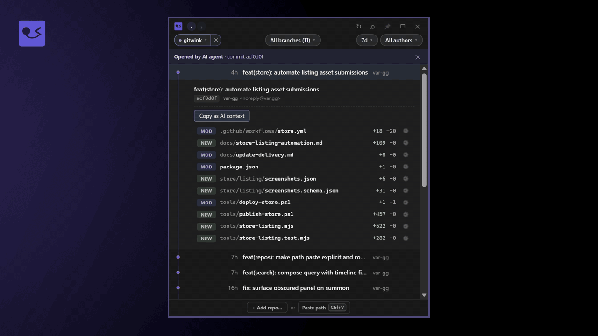
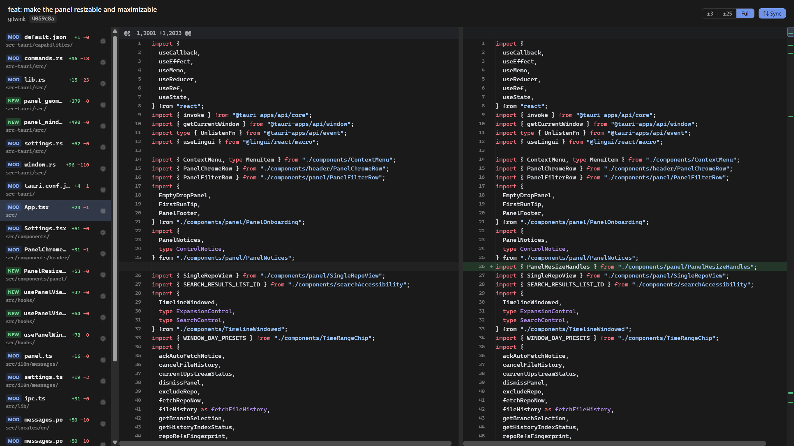

# gitwink

[English](README.md) · **한국어** · [日本語](README.ja.md)

[](https://github.com/var-gg/gitwink/releases/latest)
[](https://apps.microsoft.com/detail/9P0S21GJD53F)

> AI 에이전트 시대를 위한 트레이 상주 · 읽기 전용 git glance.

**상태:** 활발히 개발 중이며 일상적으로 사용할 수 있는 단계.



gitwink는 시스템 트레이에 산다. 클릭하면 **모든** 로컬 repo의 최근
커밋 활동을 한눈에 본다. git **클라이언트가 아니다** — commit, push,
merge, 수정 어느 것도 못 한다. 설계상 읽기 전용.

## 다운로드

**Windows — [Microsoft Store](https://apps.microsoft.com/detail/9P0S21GJD53F):**

[**Microsoft Store에서 gitwink 받기 →**](https://apps.microsoft.com/detail/9P0S21GJD53F)

또는 [WinGet](https://github.com/microsoft/winget-cli)으로:

```sh
winget install gitwink
```

Store 빌드는 인증 단계에서 Microsoft가 자동 서명하므로 SmartScreen 경고가
뜨지 않는다. 업데이트의 기준은 Microsoft Store이며, 이 기기에 인증된 새
패키지가 도착하면 gitwink 안에서 Store의 네이티브 업데이트 서비스로
다운로드·설치할 수 있다.

**Windows — [Scoop](https://scoop.sh):**

```sh
scoop bucket add var-gg https://github.com/var-gg/scoop-bucket
scoop install gitwink
```

이후 업데이트는 `scoop update gitwink`. Scoop은 빌드를 추출해 설치하므로
SmartScreen 경고가 아예 뜨지 않는다.

**또는 직접 다운로드:**

[**최신 릴리즈 다운로드 →**](https://github.com/var-gg/gitwink/releases/latest)

- **Windows** — `.exe` (NSIS 인스톨러) 또는 `.msi`
- **macOS** — `.dmg` (universal)

직접 다운로드 빌드는 현재 서명되지 않아, 첫 실행 시 Windows SmartScreen /
macOS Gatekeeper가 경고를 띄운다 — 우회 방법은 릴리즈 노트에 있다.
직접 빌드하려면 [개발](#개발) 참고.

## 코드 서명

설치 채널마다 신뢰 경로가 다르다:

- **Microsoft Store** — 인증 단계에서 Microsoft가 자동 재서명. SmartScreen 안 뜬다.
- **Scoop** — 추출 방식 설치라 SmartScreen 안 뜬다.
- **직접 다운로드** (`.exe` / `.msi`) — 현재 서명되지 않은 상태. gitwink는
  오픈소스를 위한 [SignPath Foundation](https://signpath.org/) 무상 코드
  서명 프로그램에 참여하고 있다 ([코드 서명 정책](CODE_SIGNING_POLICY.md)
  참고); 승인되면 SignPath 인증서가 이 빌드들을 서명하게 된다.

## 만든 이유

원래 VS Code에 GitLens 박아두고 살았다. 브랜치 그래프, 히트맵
blame, lens 주석 — 그게 *내* git 워크플로우였다. 그러다 2025년이
됐다. Cursor, Claude Code, Codex가 실제 코딩을 다 해주니까 에디터
자체가 선택사항이 됐다. 그래도 나를 VS Code로 끌고 가는 단 하나의
이유가 GitLens였다.

낭비 같았다 — 커밋 리스트 한 번 보려고 IDE를 통째로 켜는 게.
이제 git 커맨드는 에이전트가 친다; 나는 가끔, 뭔가 미심쩍을 때만,
결과를 한 번 확인하고 싶을 뿐이다. gitwink는 *그* 루프에 맞춘
가능한 가장 작은 도구다 — 트레이 아이콘이 펼쳐져 한눈에 보여주고,
커밋을 AI 컨텍스트로 넘겨주고, 비킨다.

commit 없음. push 없음. merge 없음. git 수술이 필요하면
에이전트한테 시킨다.

이 설계의 더 긴 논거 — 에이전트가 코드를 쓰는 시대에 git 도구가
*무엇이어야* 하는지 — 는 에세이
[에이전트가 코드를 쓴다 — git 도구는 무엇이어야 하는가](https://var.gg/ko/blog/git-tools-in-the-agent-era)
에 정리해 두었다.

## 루프

0.5초 확인 루프:

```
에이전트 커밋  →  트레이 클릭  →  인라인 펼침  →  "Copy as AI context"
                                                   →  Claude/Codex에 붙여넣기
                                                   →  "에이전트가 제대로 했나?"
```

## 기능

- 시스템 트레이 아이콘 (Windows 트레이 / macOS 메뉴바). 클릭으로
  토글, 우클릭으로 업데이트 확인 / 설정 / 패널 위치 리셋 / 종료.
- 전역 단축키 `Ctrl+Shift+G` (Windows) / `Cmd+Shift+G` (macOS)로
  어디서든 패널 호출/해제. 설정 → 단축키에서 지원되는 보조 키와
  일반 키 조합으로 바꾸면 즉시 적용된다.
- 첫 실행 시 기본 유저 디렉터리 탐색 (`source`, `Documents`,
  `Projects`, `Code`, `Dev`, `repos`, `Desktop`, Windows에선 모든
  비시스템 드라이브 / macOS에선 `~/Projects`, `~/Code`,
  `~/Documents`, `~/Developer`). 결과는
  `%APPDATA%\gg.var.gitwink\cache.db`의 SQLite에 캐시하며, 이후 패널을
  다시 열 때 학습된 워크스페이스 루트를 재확인하므로 트레이 프로세스가
  계속 실행 중이어도 새로 만든 저장소가 앱 재시작 없이 나타난다.
- 모든 repo를 가로지르는 통합 커밋 타임라인. Repo, 기간, 작성자,
  단일 repo 모드의 브랜치 필터를 함께 조합한다. 검색도 별도 화면으로
  분리되지 않고 현재 필터 조합 안에서 동작한다.
- 행별 마커 — `●` 커밋 · `◆` 머지 · `★` 태그. 현재 체크아웃된
  브랜치에 없는 커밋에는 브랜치 라벨 배지.
- 단일 repo 모드: repo 하나 고르면 패널이 브랜치별 뷰로 전환.
  커스텀 SVG DAG 차선 드로어 (8색 팔레트, 브랜치명 해시 기반;
  main / master / develop는 중립색).
- 모든 모서리와 가장자리에서 패널 크기를 조절하고, 기본/와이드
  프리셋을 선택하거나 깊이 읽을 때 최대화할 수 있다. 선호하는 일반
  크기는 UI 스케일과 별개로 기억한다.
- 클릭 시 인라인 펼침: 커밋 메시지 본문 + 변경 파일 리스트
  (NEW/MOD/REN/DEL 배지, `+/−` 라인 카운트, 바이너리는 `bin` +
  크기, GitLens 스타일 파일명 강조).
- 변경 파일 옆 시계 버튼으로 그 파일의 히스토리를 열고, 해당 파일을
  건드린 커밋 사이를 이동하며 원하는 리비전을 펼쳐 diff로 연다.
- 컨텍스트 메뉴에서 폴더를 건드리지 않고 repo를 gitwink에서 제외한 뒤,
  기존 설정을 유지한 채 설정 화면에서 나중에 복원할 수 있다.
- 별도 diff 윈도우 (싱글톤, 재사용, 위치/크기 + 최대화 상태
  영속)에서 전체 읽기: 파일 사이드바 + 가로 스크롤 동기화된
  side-by-side diff. PNG / JPG / GIF / WebP / SVG 이미지 프리뷰
  내장 (체커 배경, before/after). 로컬 Git LFS 객체 자동 조회;
  없으면 인라인으로 설명.
- Copy as AI context — `c` 키 또는 버튼 — 커밋, 파일 리스트,
  (충분히 작으면) 전체 diff를 마크다운 블록으로 출력. Claude /
  Codex / Cursor에 바로 붙여넣기.
- 작업 검토 — 두 커밋 사이의 최종 변경, 마지막 확인 이후의 변경,
  스테이징/미스테이징/미추적 파일을 한 창에서 확인한다. 저장소 선택 후
  **작업 검토**를 누른다. 확인 기준은 직접 완료를 표시할 때만 저장되며,
  검토 도중 파일이 바뀌면 새로고침을 요구한다. 미추적 파일은 직접 선택해야
  내용 보기나 복사에 포함된다.
- 선택 파일의 AI 문맥은 전체 커밋 해시, 경로, 스냅샷 식별자와 생략 안내를
  포함해 64 KiB 이내로 복사한다. AI 서비스로 자동 전송하지 않는다.
- 에이전트 제어 표면 — `gitwinkctl capabilities --json`, 정확한 커밋,
  단일 파일 히스토리, 커밋 범위, 현재 변경 화면을 연다. 읽기 전용이며 MCP나 특정
  에이전트 스킬을 강제하지 않는다. 자세한 계약은
  [Agent control](docs/agent-control.md) 참고.

## Diff 윈도우

*"잠깐, 에이전트가 그거 진짜 했나?"* 싶을 때. 커밋을 펼친 뒤 변경
파일을 선택하면 별도 윈도우가 열린다 — 파일 사이드바, 가로 스크롤
동기화 side-by-side diff, 바이너리 자산의 인라인 이미지 프리뷰,
위치/크기/최대화 상태를 기억하는 싱글톤 인스턴스.



## 기술 스택

Tauri 2 · Rust · React + TypeScript · `git2` · SQLite · 커스텀
SVG DAG 드로어 · 읽기 전용(merge·push·재작성 안 함) · 텔레메트리·애널리틱스
없음 — 네트워크는 최소한: 앱 업데이트 확인(직접 설치/Scoop은 GitHub,
Store 설치는 Microsoft Store)과 보고 있는 repo의 `origin` fetch — 패널 열 때
자동(기본 켜짐, off 가능) 또는 ↻ 버튼으로 명시적.

## 개발

```bash
pnpm install
pnpm tauri dev
```

필요: Node 20+, Rust stable (Windows에선 msvc 툴체인), Visual C++
Build Tools (Windows) 또는 Xcode CLT (macOS).

## 플랫폼

- Windows 10/11 — 주요 타깃, 개발 하드웨어에서 검증
- macOS 13+ — 동작해야 함, 덜 검증됨
- Linux — 나중에

## 라이선스

[MIT](LICENSE)
